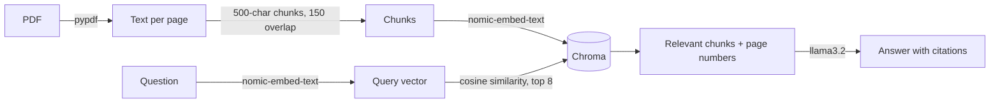

# 📄 PDF Chatbot (local RAG)

Upload a PDF and ask questions about it. Answers come **only from the document**, with page citations, and the bot says so when the answer isn't there.

Everything runs locally and free: [Ollama](https://ollama.com) for the models, [Chroma](https://www.trychroma.com) for vectors. No API keys, and your documents never leave your machine.

Built from scratch (no LangChain/LlamaIndex) to understand every step of a RAG pipeline.

## How it works



1. **Load**: extract the text of each page with `pypdf`.
2. **Chunk**: split it into overlapping 500-character windows. Chunks never cross a page boundary, so every chunk has an exact page number for citations.
3. **Embed**: turn each chunk into a 768-dimension vector with `nomic-embed-text`, using its `search_document:` / `search_query:` prefixes.
4. **Store and retrieve**: Chroma saves the vectors to disk under a hash of the PDF's contents, so each PDF is embedded only once. A question is embedded the same way, and the 8 most similar chunks (by cosine similarity) are retrieved.
5. **Generate**: `llama3.2` (3B) answers using only those chunks, cites pages, and refuses when the answer isn't in the context. The answer streams in token by token.

## Quick start

Requires Python 3.11+ and [Ollama](https://ollama.com).

```bash
ollama pull llama3.2
ollama pull nomic-embed-text
ollama serve                      # leave running (or open the Ollama app)

pip install -r requirements.txt
streamlit run app.py              # web UI
python rag.py some.pdf            # or the terminal version
```

## Evaluation

`eval.py` measures **retrieval** quality, because if the right chunk isn't retrieved, the LLM can't answer correctly. Each test case is a question plus a short *evidence* phrase copied from the PDF. A retrieval counts as a hit if one of the top-k chunks contains that phrase.

Test document: [*Attention Is All You Need*](https://arxiv.org/abs/1706.03762) (15 pages), with 17 hand-written questions worded differently from the paper (`eval_questions.json`).

```bash
curl -L -o attention.pdf https://arxiv.org/pdf/1706.03762
python eval.py attention.pdf eval_questions.json
```

| chunk size | hit@1 | hit@4 | hit@8 |
|---|---|---|---|
| 300 | 65% | 76% | 82% |
| **500** | 53% | **82%** | **88%** |
| 800 | 47% | 59% | 76% |
| 1500 | 59% | 71% | 82% |

**Findings**
- **Chunk size matters a lot.** The common default of ~800 characters was the worst setting here. Based on this, the app uses 500 characters with k=8, which raised hit@8 from 76% to 88%.
- **The first version of the metric was misleading.** It checked only whether a chunk from the right *page* was retrieved, and scored 100% at hit@4. Checking for the actual evidence text revealed chunks that came from the right page but didn't contain the answer.
- **Pure vector search misses exact facts.** For "Which optimizer was used?", the chunk with "Adam optimizer" was full of math symbols (β1 = 0.9, ϵ = 10−9) and ranked below chunks that only talked about training. Keyword search (BM25) would catch these.

Caveat: 17 questions on one document is a small sample (each question is about 6%), so treat the numbers as directional.

## Project structure

```
rag.py                the whole pipeline + terminal chat
app.py                Streamlit web UI
eval.py               retrieval evaluation
eval_questions.json   test questions with evidence phrases
test_rag.py           chunking unit test
```

## Limitations and next steps

- **Hybrid search**: combine BM25 keyword scores with vector scores to catch the exact-term misses above.
- **Reranking**: retrieve 20 chunks, then reorder them with a cross-encoder.
- **Follow-up questions**: each question is answered on its own, so "what about the second one?" doesn't work yet. This needs the question rewritten using the chat history.
- **Scanned PDFs** have no text layer and would need OCR first.
- **Small model**: llama3.2 (3B) sometimes over-explains. Larger models such as `llama3.1:8b` are slower on CPU but more precise. Change `CHAT_MODEL` in `rag.py` to switch.
